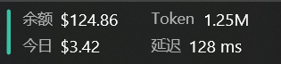
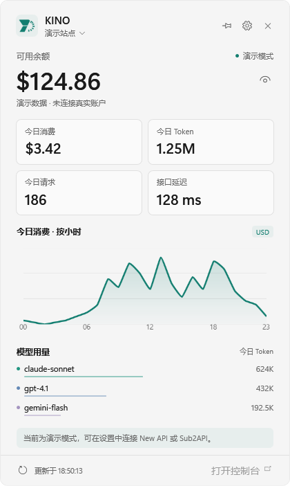
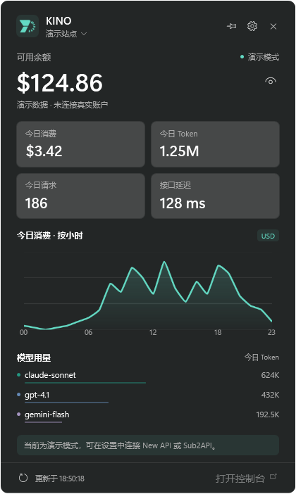
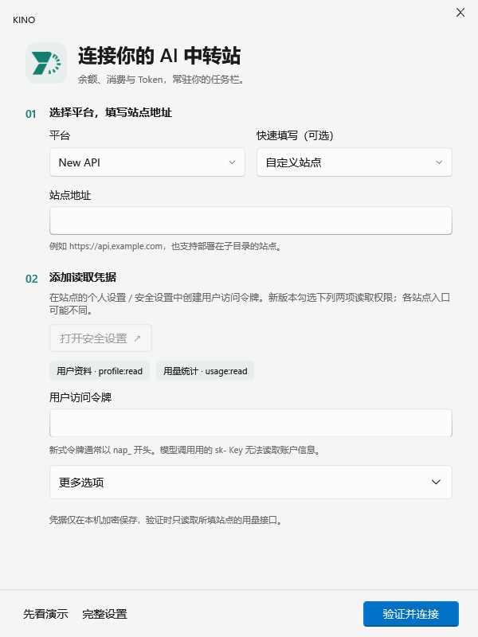
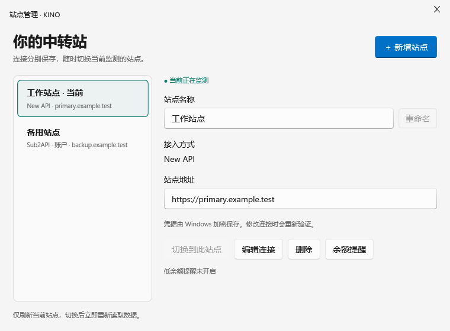
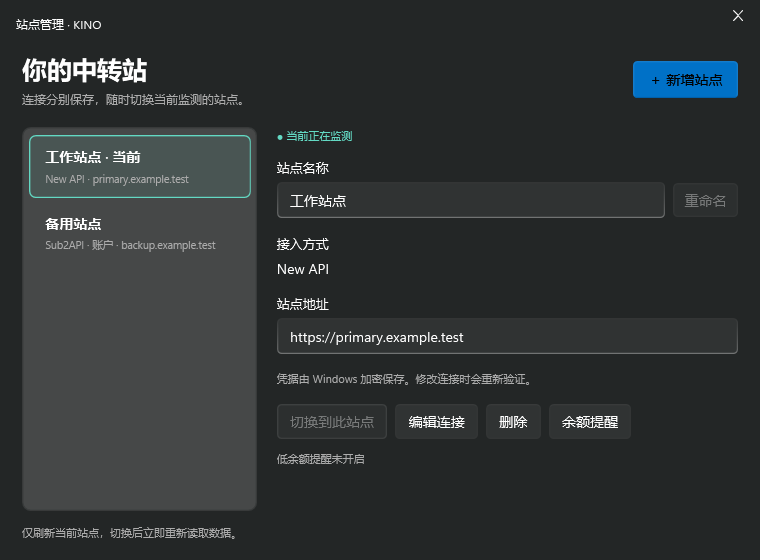
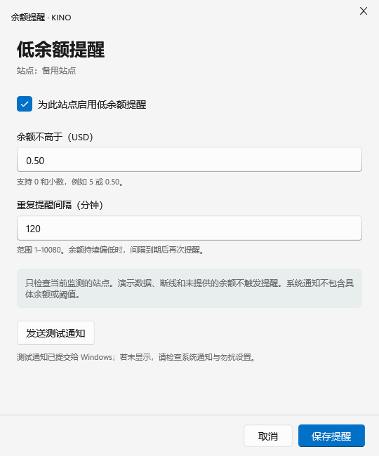
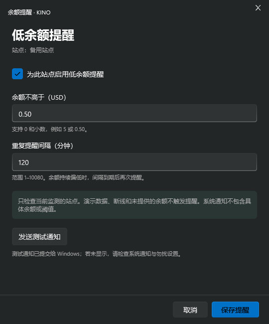

<div align="center">


# KINO

**把 AI 中转站的余额与用量，放进 Windows 任务栏。**

🪟 Windows 桌面 · 📊 用量可视化 · 🔀 多站点切换 · ✨ Fluent 卡片

[📥 下载 Windows 发布版](https://github.com/Liam-wzh/KINO/releases/latest) · [快速开始](#getting-started) · [连接站点](#connect) · [问题反馈](https://github.com/Liam-wzh/KINO/issues) · [余时中转站](https://aixyushi.com/)

</div>

不用反复打开网页，也能知道余额还剩多少、今天花了多少。KINO 在任务栏紧凑显示你关心的指标，轻点即可展开带有消费趋势与模型统计的亚克力卡片。

由 **余时工作室** 出品，支持兼容 **New API / Sub2API** 的站点。你可以填写自己的站点地址，也可以添加多个账户随时切换。

<p align="center">
  
</p>

<p align="center">
  
  
</p>

## ✨ 一眼掌握你的 AI 用量

| 功能 | 你可以做什么 |
| --- | --- |
| 🪟 任务栏监控 | 查看余额、今日消费、Token 和接口延迟，标签与数值紧凑排列 |
| 📊 用量卡片 | 展开查看请求数、消费趋势和模型统计，快速了解调用情况 |
| 🎛️ 自定义显示 | 分别选择、排序任务栏与卡片中的指标，只留下自己关心的信息 |
| 🔀 多站点管理 | 新增、编辑、重命名、删除站点，通过卡片或托盘菜单快速切换 |
| 🔔 低余额提醒 | 为每个站点设置 USD 阈值和提醒间隔，点击通知打开卡片 |
| 🎨 外观与隐私 | 浅色、深色、跟随系统；支持隐藏金额、固定卡片与拖动位置 |
| 🔐 本机保存 | 令牌使用 Windows DPAPI 加密，刷新间隔可设为 15–3600 秒 |

## 🌙 余时工作室 · 让 AI 更触手可及

<p align="center">
  <a href="https://aixyushi.com/">
    <picture>
      <source media="(prefers-color-scheme: dark)" srcset="docs/images/studio-logo-dark.png" />
      
    </picture>
  </a>
</p>

**KINO 是余时工作室为 AI 用户打造的桌面工具，余时中转站则是工作室提供的 AI API 接入服务。** 我们希望让调用更省心，也让每一笔消耗更清楚。

如果你正在寻找日常使用的 AI 中转站，欢迎试试 **[余时 · Yushi](https://aixyushi.com/)**。余时主打 **低廉价格、稳定服务、高缓存命中与透明计费**：

| 我们关注的体验 | 为什么值得试试 |
| --- | --- |
| 💰 价格低廉 | 降低日常 AI 使用成本，让开发、学习和长时间使用更轻松 |
| ⚡ 稳定接入 | 重视服务稳定性，让日常调用与持续使用更省心 |
| 🎯 高缓存命中 | 重视缓存利用，适合连续对话、重复上下文等使用场景 |
| 🧾 价格透明 | 价格与计费规则以站点公示为准，使用前了解成本，使用后查看消耗 |

**[🚀 前往余时中转站 → https://aixyushi.com/](https://aixyushi.com/)**

余时使用 New API。在 KINO 连接向导中选择 **New API**，填写 `https://aixyushi.com` 和自己的用户访问令牌，即可在任务栏查看用量。具体模型价格、缓存支持与计费规则请查看站点说明。

<a id="getting-started"></a>

## 🚀 快速开始

运行环境：**Windows + .NET Framework 4.8**。目前主要在 Windows 11 上验证。

**[📥 下载 Windows 发布版](https://github.com/Liam-wzh/KINO/releases/latest)**，选择附件中的 `KINO-<版本>-windows.zip`。这是可直接运行的免安装版，**无需安装开发工具或自行构建**。GitHub 自动生成的 `Source code` 压缩包仅包含源码。

1. 下载并完整解压 `KINO-<版本>-windows.zip`，运行 `KINO.exe`。保留同目录的 `x86`、`x64`、`arm64` 文件夹，它们包含图表所需的原生依赖。
2. 首次启动时选择平台、填写 HTTPS 站点地址和凭据，点击 **验证并连接**。也可以点击 **先看演示**，离线体验界面。
3. 点击任务栏信息或托盘图标打开用量卡片，点击齿轮进入设置。
4. 在 **显示内容** 中选择、排序指标，在 **外观与刷新** 中调整主题、金额隐藏和刷新间隔。

<a id="connect"></a>

## 🔌 连接你的站点

支持自行部署或第三方提供的兼容站点，也支持部署在子目录的地址。不同接口的凭据和统计范围有所区别：

| 接入方式 | 填写的凭据 | 统计范围 |
| --- | --- | --- |
| New API | 用户访问令牌，部分版本还需用户 ID | 整个账户 |
| Sub2API · API Key | 站点生成的 API Key | 当前 Key |
| Sub2API · 账户 | 登录账户的访问令牌 JWT | 整个账户 |

**New API**：新版本用户访问令牌需授予 `profile:read` 和 `usage:read` 权限。模型调用用的 `sk-` Key 不能读取账户资料；今日统计需要站点开启数据看板。接口未提供的字段显示 `—`。

**Sub2API**：API Key 模式支持 `sk-` Key。账户模式的 JWT 到期后需重新填写，软件不保存网页登录密码、不自动续期。Key 模式的可用金额可能是钱包余额、Key 剩余额度或订阅额度，缺失时显示 `—`。

### 🔀 多站点与快速切换

通过 **管理站点 → 新增站点** 添加其他账户。每个站点独立保存连接、凭据和余额提醒；主题、显示项、金额隐藏和刷新间隔为全局偏好。

点击卡片顶部的站点名称，或使用托盘菜单，即可切换当前站点。切换时清除旧站点数据并重新刷新，取消编辑不会更改已保存的连接。

### 🖱️ 卡片操作

- 点击外部或按 **Esc** 收起卡片；点击图钉后可以固定卡片，并拖动标题调整位置。
- 右键任务栏信息或托盘图标，可以刷新、打开设置或退出。
- 任务栏数值过长时显示省略号，展开卡片可查看完整值。

<details>
<summary>🖼️ 更多界面预览</summary>

<p align="center">
  
</p>

<p align="center">
  
  
</p>

<p align="center">
  
  
</p>

</details>

## 🔔 余额不足，及时知道

在 **设置 → 余额提醒** 中配置当前站点，或通过 **站点管理 → 选择站点 → 余额提醒** 配置其他站点。提醒默认关闭，开启后可设置 USD 阈值和重复间隔，间隔范围为 1–10080 分钟，默认 60 分钟。

只有当前站点成功刷新、余额不高于阈值时才会提醒。演示数据、断线、过期数据和未知余额不会触发通知；切换站点、刷新或重启会保留提醒冷却时间。

通知不展示具体金额，点击后可打开卡片查看。可以通过 **发送测试通知** 检查 Windows 通知设置；实际展示受勿扰模式等系统设置影响。

## 🔐 数据与隐私

配置保存在本机 `%LOCALAPPDATA%\KINO\settings.json`，令牌通过 Windows DPAPI 加密，只能由同一 Windows 用户解密。日志位于同目录的 `kino.log`；提醒记录 `alert-history.json` 只保存站点 ID 和通知提交时间。

金额按 **USD** 展示，不做汇率换算。New API 根据站点额度比例换算，今日统计按本机日期查询；Sub2API 使用实际扣费 `actual_cost`，今日汇总跟随站点时区。接口延迟为用量查询的 HTTP 往返耗时。

<details>
<summary>📡 读取哪些接口？</summary>

| 接入方式 | 读取接口 |
| --- | --- |
| New API | `/api/user/self`、`/api/status`、`/api/data/self` |
| Sub2API · API Key | `/v1/usage` |
| Sub2API · 账户 | `/api/v1/auth/me`、`/api/v1/usage/dashboard/*` |

</details>

分享配置或反馈问题时，请隐藏令牌和真实账户信息。仓库已通过 `.gitignore` 排除本机配置、日志和构建产物。

## 🧪 兼容性与项目状态

已在 **Windows 11 主显示器任务栏、150% 缩放** 下验证嵌入、文字渲染与点击展开收起；原生文字绘制另检查了 100%、150%、200% 缩放。浅深主题、配置、图表、多站点切换和提醒规则均有自动检查。

New API 已完成一个真实站点的只读联调；Sub2API 目前通过模拟接口验证，实际站点的版本和权限仍需核对。Windows 10 尚未实机验证。当前没有多显示器选择、开机启动、自动更新、安装器或代码签名。

<a id="development"></a>

## 🛠️ 开发与构建

技术栈：**C# / WPF / .NET Framework 4.8**，使用 DirectN、FluentWpfCore、WPF UI 与 LiveCharts2。需要 Windows 和 **.NET SDK 10.x**，`global.json` 固定 SDK 版本范围。

```powershell
git clone https://github.com/Liam-wzh/KINO.git
cd KINO
dotnet build Kino.slnx -c Debug
.\src\Kino\bin\Debug\net48\KINO.exe
```

<details>
<summary>📦 检查、打包与维护约定</summary>

```powershell
# 构建与核心测试；-IncludeUi 需要有交互桌面的 Windows 会话
pwsh -NoProfile -File tools/check.ps1
pwsh -NoProfile -File tools/check.ps1 -IncludeUi

# 原生任务栏、首次连接与通知检查，使用演示数据
pwsh -NoProfile -File tools/verify-taskbar.ps1 -Configuration Release
pwsh -NoProfile -File tools/verify-onboarding.ps1
pwsh -NoProfile -File tools/verify-notifications.ps1 -RequireVisible

# 根据项目版本生成 artifacts/KINO-<版本>-windows.zip 及 SHA256 校验文件
pwsh -NoProfile -File tools/publish.ps1
```

界面截图位于 `artifacts/previews`。程序提供 `--preview`（演示卡片）、`--connect-preview`（空白连接向导）、`--notification-preview`（发送演示通知，20 秒后退出）和 `--diagnose`（任务栏诊断，8 秒后退出）；这些模式隔离真实账户配置。

GitHub Actions 在推送、拉取请求或手动触发时执行 Windows 构建、核心测试与打包，运行记录见 [Windows build](https://github.com/Liam-wzh/KINO/actions/workflows/build.yml)。UI 与 Explorer 任务栏行为需要本机检查。源码与下载包分别维护，`artifacts/` 不提交到仓库。

发布新版本时，先更新 `src/Kino/Kino.csproj` 的版本并提交，再创建对应的 `v<版本>` 标签并推送。`Windows release` 工作流会检查标签与项目版本一致，运行核心测试、生成 ZIP 和 SHA256 文件，并发布到 GitHub Releases。例如当前版本：

```powershell
git tag -a v0.6.2 -m 'KINO 0.6.2'
git push origin v0.6.2
```

当前维护工作区的 `origin` 已配置向 GitHub 与 Gitee 同时推送；新克隆的仓库需自行添加 Gitee 远端。Gitee 的源码与标签可同步，GitHub Releases 的附件需要另行上传到 Gitee。

核心代码位于 `src/Kino`：`Models` 定义配置与可空指标，`Services` 负责接口、状态与加密保存，`Interop` 负责原生任务栏，`UI` 负责卡片和窗口。

- `MonitorController` 是唯一快照来源；平台请求放在服务层，UI 不直接联网。缺失统计保持 `null`，真实账户不使用演示数值。
- 切换账户取消旧请求、清空旧快照与图表；保存失败不更改当前连接。预设仅保存公开地址，不能成为默认连接目标。
- 任务栏在独立 STA 线程使用 Direct2D / DirectWrite / DirectComposition；WPF 主线程管理窗口。原生改动需检查 Explorer 父窗口、DPI 和退出后的任务栏空间恢复。
- 接口与控制器改动运行核心测试，WPF 改动运行双主题界面检查。测试使用虚构凭据，不提交真实配置、令牌、日志或账户快照；错误日志不回显服务端原始内容。
- 源码使用 UTF-8。构建输出被运行中的程序锁定时，通过退出菜单或在该 EXE 目录创建 `shutdown.sentinel` 正常退出后再构建。

New API 可选诊断脚本为 `tools/probe-newapi.ps1 -BaseUrl <站点地址>`，默认仅访问公开接口；`-UseSavedCredentials` 仅在账户持有人授权后读取本机已保存凭据。脚本只输出状态与字段可用性，不输出令牌或账户金额。

应用图标原图位于 `design/branding/logo-original.png`，工作室横版 Logo 原图位于 `design/branding/studio-wordmark-original.png`。README 使用的横版 Logo 已裁去留白，并提供适配 GitHub 浅色、深色主题的图片。透明应用素材和多尺寸 ICO 已随源码提供；修改应用图稿后可重新生成，日常构建无需 Python：

```powershell
python -m pip install -r tools/requirements-assets.txt
python tools/generate_icon.py
```

</details>

## 🤝 致谢与许可

任务栏集成参考 [TaskMonitor](https://github.com/linesoft2/TaskMonitor)，保留其 Apache-2.0 许可与署名。第三方组件清单见 [THIRD-PARTY-NOTICES](licenses/THIRD-PARTY-NOTICES.txt)，完整许可位于 [licenses](licenses/)；项目主许可证尚待确定。

如果 KINO 对你有帮助，欢迎点亮 ⭐ Star、[反馈问题](https://github.com/Liam-wzh/KINO/issues)或贡献改进。也欢迎来 [余时中转站](https://aixyushi.com/) 体验，让 KINO 陪你一起看清 AI 用量。
